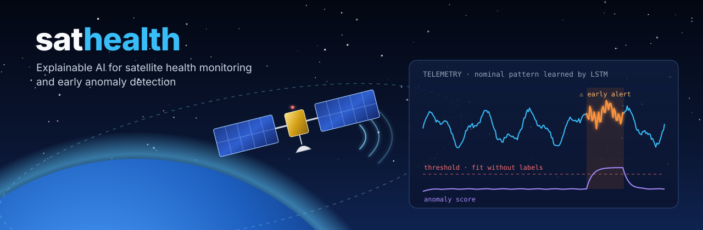
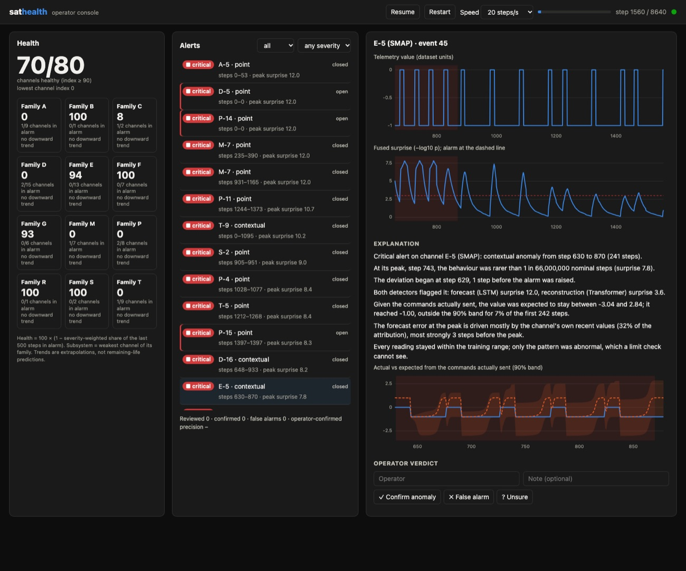
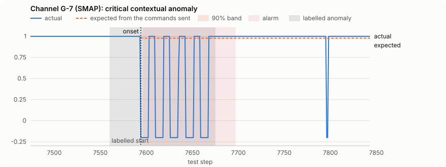

<p align="center">
  
</p>

# sathealth: explainable satellite health monitoring

AI-based satellite health monitoring with early anomaly detection and explainable alerts.
Built for the **Odisha Seva First Innovation Challenge**.

Satellites downlink thousands of telemetry channels. Fixed limit checks miss slow drifts and
broken relationships between channels, and they never say *why*. sathealth combines an
ensemble of detectors with an explainability layer, so each alert says which channel, when
the problem started, which dependency broke and what normal would have looked like.

> **Status: all seven phases complete.** The Phase 4 gains on SMAP did **not** replicate on an
> independent spacecraft (ESA OPS-SAT, pre-registered): see
> [docs/CONFIRMATION.md](docs/CONFIRMATION.md). See [docs/ROADMAP.md](docs/ROADMAP.md) and
> the results in [BASELINES.md](docs/BASELINES.md) (detectors),
> [DECISION.md](docs/DECISION.md) (alarms) and [EXPLAINABILITY.md](docs/EXPLAINABILITY.md)
> (explanations).

## Quickstart

Requires [uv](https://docs.astral.sh/uv/) and Python 3.12+.

```bash
make install     # uv sync + git hooks
make download    # NASA SMAP/MSL, 165 files / 173 MB, every file SHA-256 verified
make prepare     # validate → split → scale → data/processed/telemanom-<fingerprint>/
make evaluate-baselines  # classical baselines (~20 s)
make leaderboard # every detector incl. deep models → docs/BASELINES.md (~1 h on 4 cores)
make ablation    # every decision-layer variant on saved scores → docs/DECISION.md (seconds)
make explain     # explain live alarms + evaluate → docs/EXPLAINABILITY.md (~10 min first time)
make serve       # operator console on http://127.0.0.1:8000 (API docs at /docs)
make demo        # headless: replay → explained alert → operator verdict stored
make confirm     # one-shot pre-registered test on ESA OPS-SAT → docs/CONFIRMATION.md (~12 min)
make check       # ruff + mypy --strict + unit tests
make test-data   # integration tests against the real dataset
```

Use prepared data from Python:

```python
from pathlib import Path
from sathealth.pipeline.prepare import load_prepared

channel = load_prepared(Path("data/processed/telemanom-84ff983f088d"), "P-1")
X = channel.windows("train", size=100)  # (N, 100, 25) zero-copy view
y = channel.test_window_labels(size=100)  # (N_test,) bool
```

Deep models train one network per channel on CPU. `sathealth evaluate lstm --jobs 7` spreads
channels over 7 processes; results are bit-identical for any `--jobs` value. To also log runs
to MLflow: `uv sync --extra tracking`, then add `--set tracking.mlflow_uri=file:./mlruns`.

The decision layer runs on saved scores in seconds: `sathealth decide` runs the pre-registered
pipeline, and `sathealth decide --config configs/live.yaml` the live pipeline with streaming
recalibration. Each run writes operator-facing events (span, peak, severity, point or
contextual type, per-detector evidence) to `runs/decisions/<name>-<fingerprint>/events/`.

Every command accepts `--config` and `--set key.sub=value`, for example
`sathealth prepare --set dataset.spacecraft=[SMAP] --set preprocess.scaler=standard`.
`sathealth info` prints the resolved config.

## What Phase 1 guarantees

| Guarantee | How |
|---|---|
| **Integrity**: no corrupt data reaches a model | Pinned mirror commit; size and SHA-256 manifest; atomic `.part` writes; retries; `prepare` re-verifies first ([ADR 0001](docs/adr/0001-dataset-source.md)) |
| **Correct labels** | Explicit duplicate policy (`P-2`), sorting, bounds checks ([ADR 0002](docs/adr/0002-label-cleaning.md)) |
| **No leakage** | Chronological split, then the scaler is fit on train rows only, then windows are built per split ([ADR 0003](docs/adr/0003-train-only-robust-scaling.md)) |
| **Known data quality** | Per-channel ERROR/WARNING/INFO checks, published in [docs/DATA_CARD.md](docs/DATA_CARD.md) |
| **Reproducibility** | Output directory keyed by a config fingerprint; `manifest.json` records config, git commit, raw digest and scaler parameters |
| **Honest evaluation** | Thresholds never see labels; composite F1 headline; bootstrap CIs; random-score control ([ADR 0004](docs/adr/0004-evaluation-protocol.md)) |
| **Engineering quality** | `mypy --strict`, ruff, >90% branch coverage, CI on Python 3.12 and 3.13, plus a real-data CI job |

## Results (Phases 2 and 3)

All 80 channels, thresholds fit without labels ([protocol](docs/adr/0004-evaluation-protocol.md)):

| Detector | Composite F1 [95% CI] | AUC-PR | Events found (of 103) | Point-adjusted F1 ⚠ |
|---|---|---:|---:|---:|
| **Transformer autoencoder** | **0.524** [0.33, 0.68] | 0.425 | 75 | 0.620 |
| Limit check (today's practice) | 0.458 [0.30, 0.58] | 0.268 | 47 | 0.509 |
| **LSTM forecaster** | 0.444 [0.32, 0.57] | **0.441** | **91** | 0.558 |
| Robust z-score | 0.395 [0.26, 0.52] | 0.312 | 60 | 0.506 |
| Isolation Forest | 0.372 [0.22, 0.50] | 0.323 | 65 | 0.589 |
| Random scores | 0.210 [0.11, 0.29] | 0.124 | 36 | **0.897** |

What Phase 3 showed ([ADR 0005](docs/adr/0005-deep-detectors.md)):

- **The deep models rank anomalies significantly better.** In a paired bootstrap against the
  best baseline, AUC-PR rises by +0.118 [+0.058, +0.181] (LSTM) and +0.102 [+0.039, +0.168]
  (Transformer). The LSTM finds **91 of 103** anomalies; the limit check finds 47.
- **At a fixed threshold the gain is not yet significant.** The Transformer leads on composite
  F1 (+0.112 on SMAP), but the paired interval [−0.002, +0.246] touches zero. A single static
  threshold turns good scores into runs of false alarms. Fixing that is Phase 4's job.
- **Random scores beat every real detector on point-adjusted F1**, which is why we don't
  headline it.

## Decision layer (Phase 4)

Phase 4 turns scores into alarms an operator can act on: EVT calibration to a common
"surprise" scale, fusion of the LSTM and Transformer, hysteresis, and events with severity,
type and evidence ([ADR 0006](docs/adr/0006-decision-layer.md),
[full results](docs/DECISION.md)). The primary pipeline and the alarm budget were
**pre-registered** before any result.

| Pipeline | Composite F1, all / SMAP | Δ vs limit check on SMAP [paired 95% CI] | False events / 1k steps |
|---|---|---|---:|
| Limit check (today's practice) | 0.458 / 0.475 | — | 1.03 |
| Primary, pre-registered | 0.459 / 0.502 | +0.028 [−0.086, +0.146] | 1.30 |
| Telemanom dynamic threshold (batch) | 0.578 / 0.641 | +0.166 [+0.029, +0.317] | 0.43 |
| Streaming recalibration (live, **post-hoc**) | 0.531 / 0.623 | +0.148 [+0.047, +0.279] | 0.23 |

- **The pre-registered criterion is not met**, and we report that rather than tune on test
  labels.
- **We found why: the validation-to-test shift.** "Once in 1,000 nominal steps" fires on 7–20%
  of nominal test steps. That is visible without labels, and it holds even for the z-score.
- **Methods that adapt to the stream beat the limit check on SMAP with 2–4× fewer false
  alarms.** The live variant was designed after seeing results, so it was tested once on an
  independent spacecraft in Phase 7 — and **did not replicate** (see below).
- **Anomaly type** (point vs contextual) matches the labels 80% of the time (majority class:
  68%).

## Independent confirmation and extensions (Phase 7)

The Phase 4 results were tested once, with every setting fixed in advance, on a different
spacecraft: ESA's OPS-SAT cubesat (OPSSAT-AD, CC-BY-4.0; [ADR 0009](docs/adr/0009-extensions-and-confirmation.md)).

| Pre-registered hypothesis | Result on OPS-SAT | Verdict |
|---|---|---|
| The live pipeline beats the best baseline | −0.254 composite F1 vs robust z-score, 95% CI [−0.364, −0.128] | **not supported** |
| The Telemanom reference beats the best baseline | +0.016, 95% CI [−0.079, +0.135] | **not supported** |
| Priming removes the start-up transient on SMAP/MSL | start-up events 19 → 32 | **not supported** |

**What this means:** on SMAP the deep, adaptive pipeline is the strongest; on OPS-SAT a robust
z-score is as good as anything here. Gains on one benchmark are not a property of the method.
For a new mission: start with the simple baseline, run the deep pipeline in shadow mode, and
let operator verdicts decide ([CONFIRMATION.md](docs/CONFIRMATION.md), [PRIMING.md](docs/PRIMING.md)).

Also added: **operator re-baselining** (accept a confirmed permanent shift as the new normal,
audited), a **label-free drift monitor** in the console, and a measured **edge feasibility
check** (int8 shrinks the LSTM 3.4×, but runs slower on a laptop CPU; target hardware decides).

## Operator console (Phase 6)

`make serve` starts the service and opens the console at http://127.0.0.1:8000. Every alert
streams in live, with its explanation, a counterfactual chart and buttons to confirm it or
mark it a false alarm ([ADR 0008](docs/adr/0008-operations-service.md)).



- **Live = batch:** the step-by-step decision engine reproduces the offline results exactly
  (199 of 199 events), so every number in this README describes what the console shows.
- **Health:** a per-channel index (severity-weighted share of recent steps in alarm) rolled up
  per channel family. There is no remaining-useful-life claim, because the data has no
  run-to-failure histories; trends are labelled extrapolations.
- **Feedback:** operator verdicts are stored in SQLite, summarised as operator-confirmed
  precision, and exported for retraining.
- **Production basics:** health and readiness probes, Prometheus metrics, OpenAPI docs,
  server-sent events, p95 latency under 2.5 ms with 80 channels.

## Explainable alerts (Phase 5)

Every alarm comes with an explanation an operator can check
([ADR 0007](docs/adr/0007-explainability.md), [full results](docs/EXPLAINABILITY.md)):



> Critical alert on channel G-7 (SMAP): contextual anomaly from step 7596 to 7697 (102 steps).
> At its peak, step 7667, the behaviour was rarer than 1 in 3,300,000,000 nominal steps
> (surprise 9.5). The deviation began at step 7594, 2 steps before the alarm was raised.
> Both detectors flagged it: reconstruction (Transformer) surprise 12.0, forecast (LSTM)
> surprise 7.0. Given the commands actually sent, the value was expected to stay between
> 0.99 and 1.01; it reached -0.20, outside the 90% band for 44% of the first 104 steps. The
> forecast error at the peak is driven mostly by the channel's own recent values (100% of
> the attribution), most strongly 2 steps before the peak. Every reading stayed within the
> training range; only the pattern was abnormal, which a limit check cannot see.

- **Grounded by construction:** every number in every sentence is checked against the
  computed facts. 1,373 of 1,373 sentences pass. An optional Claude rewording
  (`explain.llm`) is shown only if it passes the same check.
- **The right model:** the explainer rebuilds each LSTM and verifies it reproduces the saved
  scores before explaining anything (70 of 70 channels).
- **Honest evaluation:** attribution finds injected causes well above chance, but two of the
  four pre-registered hypotheses failed. Diagnosing them showed the LSTM ignores the
  commands, which sets up Phase 7.

## What we found in the data

- The original NASA archive is offline (HTTP 403). A naive parallel download **silently
  truncated 12 of 164 files**.
- `P-2` has two conflicting label rows and is dropped, leaving **80 channels (53 SMAP, 27 MSL)
  and 103 anomaly events**.
- **16 channels are constant in train**. For example `M-6` is −1 throughout train and reaches
  258 in test.
- **15 channels show distribution shift**: unlabelled test points outside the train range.

Full details are in [docs/DATA_CARD.md](docs/DATA_CARD.md).

## Repository layout

```
configs/           YAML configs (default.yaml, live.yaml)
docs/              architecture, roadmap, data card, ADRs
scripts/           maintainer tools (manifest builder, README banner)
src/sathealth/
  config.py        typed configuration
  cli.py           `sathealth` command
  data/            download, manifests, Telemanom loader, schema
  features/        validation, scaling, windowing
  evaluation/      metrics, label-free thresholds, aggregation + bootstrap CIs
  detectors/       limit check, robust z-score, Isolation Forest, random, LSTM, Transformer
  decision/        EVT calibration, fusion, alarm rules, streaming recalibration, events
  explain/         onset, counterfactual, Integrated Gradients, grounded narrative, LLM
  ops/             streaming decision engine, health index, trend extrapolation
  service/         FastAPI app, SSE stream, replay engine, SQLite store, web console
  models/          PyTorch networks, training loop, device and seeding, error smoothing
  pipeline/        prepare, evaluate, decide, ablation, explain, reports, leaderboard
  utils/           hashing, seeding, provenance, parallel map
tests/             unit tests + integration/ (real data, `-m data`)
```

Architecture: [docs/ARCHITECTURE.md](docs/ARCHITECTURE.md).

## Data citation

> K. Hundman, V. Constantinou, C. Laporte, I. Colwell, T. Soderstrom. *Detecting Spacecraft
> Anomalies Using LSTMs and Nonparametric Dynamic Thresholding.* KDD 2018.
> [arXiv:1802.04431](https://arxiv.org/abs/1802.04431)
