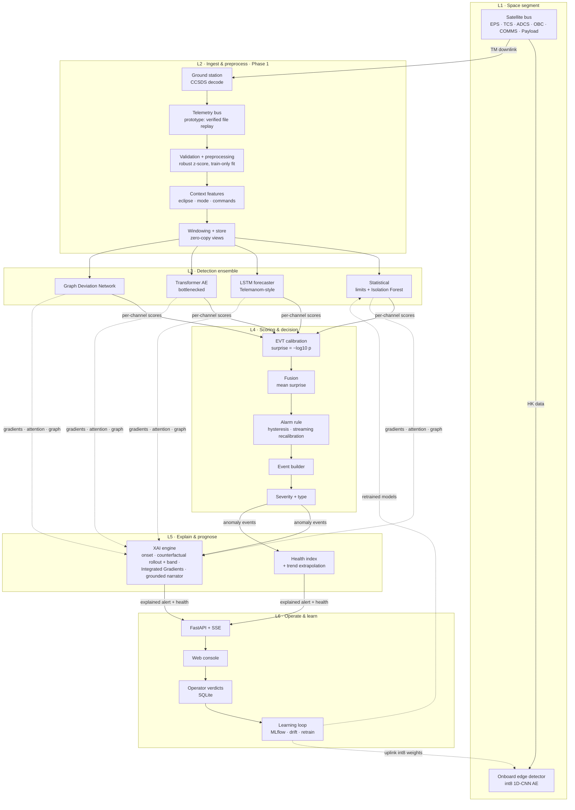

# System architecture

The target system has six layers. **Phase 1 implements L2** (ingest and preprocessing) for
the NASA SMAP/MSL benchmark. **Phase 2 adds the evaluation harness and the L3 statistical
baselines. Phase 3 adds the L3 deep detectors** (LSTM forecaster, Transformer autoencoder) **,
Phase 4 the L4 decision layer** (EVT calibration, fusion, alarms, events) **, Phase 5 the
L5 explanation engine** (onset, counterfactual, attribution, grounded narrative) **and Phase 6
the L6 operations service** (live decisions, health, API, console, feedback).
The other layers arrive in the phases listed in
[ROADMAP.md](ROADMAP.md).



## Phase 1 data flow (implemented)

```
sathealth download ──► data/raw/telemanom/          165 files, every one SHA-256 verified
                        │
sathealth prepare ─────►├─ integrity gate             re-verify checksums, refuse on mismatch
                        ├─ label cleaning             duplicate policy, sort, bounds (ADR 0002)
                        ├─ quality validation         ERROR / WARNING / INFO per channel
                        ├─ chronological split        train | val (last 20%) per channel
                        ├─ scaler fit on train only   robust median/IQR (ADR 0003)
                        └─► data/processed/telemanom-<fingerprint>/
                              manifest.json            config, git commit, raw digest, scalers
                              quality_report.json
                              channels/<id>.npz        float32 train/val/test + labels
                        │
load_prepared() ───────► PreparedChannel.windows()    zero-copy (N, w, D) views at load time
```

## Module map

| Module | Responsibility |
|---|---|
| `sathealth.config` | Typed, frozen, strict YAML config with `--set` overrides |
| `sathealth.data.download` | Manifest-driven, atomic, retrying, checksum-verified download |
| `sathealth.data.telemanom` | Label parsing and cleaning, channel loading |
| `sathealth.data.schema` | Domain types: `ChannelData`, `AnomalySegment`, label masks |
| `sathealth.features.validation` | Data quality checks with severities |
| `sathealth.features.scaling` | Train-only robust or standard scalers, JSON-serialisable |
| `sathealth.features.windowing` | Zero-copy windows, window labels, chronological split |
| `sathealth.pipeline.prepare` | Atomic, idempotent prepare run with a provenance manifest |
| `sathealth.pipeline.report` | Markdown data card generator |
| `sathealth.evaluation.metrics` | Point, event-wise, composite and point-adjusted metrics; delays; AP; oracle |
| `sathealth.evaluation.thresholds` | Label-free thresholds from nominal validation scores |
| `sathealth.evaluation.aggregate` | Micro/macro aggregation, subsets, bootstrap CIs over channels |
| `sathealth.detectors` | `Detector` interface, limit check, robust z-score, Isolation Forest, random, LSTM, Transformer, registry |
| `sathealth.models` | PyTorch networks, training loop with early stopping, deterministic seeding, causal EWMA |
| `sathealth.pipeline.evaluate` | Atomic, fingerprinted evaluation runs with saved scores; parallel over channels |
| `sathealth.pipeline.leaderboard` | `docs/BASELINES.md` generator with paired comparisons vs the best baseline |
| `sathealth.pipeline.tracking` | Optional MLflow logging of finished runs |
| `sathealth.decision` | EVT tail calibration, fusion, hysteresis and dynamic-threshold alarms, streaming recalibration, events with severity and type |
| `sathealth.pipeline.decide` | Decision runs on saved scores: events, fused surprise, diagnostics, global oracle |
| `sathealth.pipeline.ablation` | Pre-registered decision variants → `docs/DECISION.md` |
| `sathealth.explain` | Onset, counterfactual rollout and band, Integrated Gradients, grounded narrative and checker, optional grounded LLM rewording |
| `sathealth.pipeline.explain` | Verified model rebuild and cache; per-event explanations (JSON, Markdown, arrays) |
| `sathealth.pipeline.explain_eval` / `explain_report` | Pre-registered evaluation (E1–E4) → `docs/EXPLAINABILITY.md` |
| `sathealth.ops` | `StreamingDecider` (step-by-step decision layer, exact batch parity), health index, trend extrapolation |
| `sathealth.service` | SQLite store, replay engine, FastAPI app with SSE, web console, headless demo |
| `sathealth.cli` | `sathealth download / verify / prepare / report / evaluate / decide / ablation / explain / explain-report / serve / demo / leaderboard / info` |
